> 学习线索：请求进来 → 选路由 → 组装过滤器链 → 负载均衡改写地址 → Netty 转发下游 → 响应写回。
> 本文以「一次请求的完整生命周期」为主线，先讲骨架，再逐节点展开，最后结合本项目 `ld-gateway` 的自定义过滤器验证。

---

## 一、全景链路（先看骨架）

关键节点调用关系（自上而下 = 请求执行顺序）：

```
ReactorHttpHandlerAdapter          // Netty ↔ Spring 的适配入口
   apply()
HttpWebHandlerAdapter              // 统一拦截所有请求，创建 ServerWebExchange
   handle()
ExceptionHandlingWebHandler        // 全局异常处理（责任链最外层）
   handle()
FilteringWebHandler (WebFlux 的)   // 执行 WebFlux 级 WebFilter
   handle()
DispatcherHandler                  // 分发：从 HandlerMapping 里找 handler
   handle() → getHandler() → invokeHandler()
RoutePredicateHandlerMapping       // 匹配 Route（找当前请求要转发的服务）
   getHandlerInternal()
FilteringWebHandler (Gateway 的)   // 组装并执行 GatewayFilter / GlobalFilter
   handle()
DefaultGatewayFilterChain          // 过滤器链，真正"接力"执行
   filter()
RouteToRequestUrlFilter            // 封装目标 URL 到 exchange
ReactiveLoadBalancerClientFilter   // 负载均衡：lb://service → http://ip:port
NettyRoutingFilter                 // 用 Netty HttpClient 发起远程调用
NettyWriteResponseFilter           // 包裹整条链，最后把下游响应写回客户端
```



```plantuml
@startuml SpringGateway全景链路
skinparam defaultFontName "Microsoft YaHei"
skinparam rectangle {
    BackgroundColor #E74C3C
    FontColor white
    BorderColor #C0392B
}
skinparam rectangle<<filter>> {
    BackgroundColor #7F8C8D
    FontColor white
    BorderColor #566573
}

actor "客户端" as client #White

rectangle "ReactorHttpHandlerAdapter\napply()\n(Netty ↔ Spring 适配入口)" as A
rectangle "HttpWebHandlerAdapter\nhandle()\n封装 ServerWebExchange" as B
rectangle "ExceptionHandlingWebHandler\nhandle()\n全局异常处理" as C
rectangle "FilteringWebHandler (WebFlux)\nhandle()\n执行 WebFilter" as CW
rectangle "DispatcherHandler\nhandle()\nHandlerMapping 查找 Handler" as D
rectangle "RoutePredicateHandlerMapping\ngetHandlerInternal()\n匹配 Route" as RPHM
rectangle "DispatcherHandler\ninvokeHandler()\n执行 Handler 对象" as E
rectangle "FilteringWebHandler (Gateway)\nhandle()\n合并+排序过滤器\nnew DefaultGatewayFilterChain" as F
rectangle "DefaultGatewayFilterChain\nfilter()\n执行所有过滤器(接力)" as G

rectangle "RouteToRequestUrlFilter\nfilter()\n封装目标 URL (lb://)" as H <<filter>>
rectangle "ReactiveLoadBalancerClientFilter\nfilter()\n负载均衡 lb:// → http://ip:port" as I <<filter>>
rectangle "NettyRoutingFilter\nfilter()\nNetty HttpClient 执行远程调用" as J <<filter>>
rectangle "NettyWriteResponseFilter\n(post 阶段)写回下游响应" as K <<filter>>

client --> A
A --> B
B --> C
C --> CW
CW --> D
D --> RPHM
RPHM --> E
E --> F
F --> G
G --> H
H --> I
I --> J
J ..> K : 响应回来后才写回
@enduml
```

> 说明：红色为 WebFlux 主干处理链（自上而下），灰色为进入 Gateway 过滤器链后按 order 依次执行的 `GlobalFilter`。`NettyWriteResponseFilter`(order=-1) 虽在链头注册，但写回动作挂在链尾 post 阶段，故用虚线表示。
>
> ℹ️ 最顶端的 `ReactorHttpHandlerAdapter.apply()`（Netty 请求如何进入 Spring 链）的启动与绑定细节，见第十二节。

> ⚠️ 注意：链路里有**两个 `FilteringWebHandler`**，容易混淆：
> - WebFlux 自带的 `org.springframework.web.server.FilteringWebHandler`：执行的是 **`WebFilter`**（进程级，早于路由匹配）。
> - Gateway 的 `org.springframework.cloud.gateway.handler.FilteringWebHandler`：执行的是 **`GatewayFilter` / `GlobalFilter`**（路由匹配之后）。
> 两者不是一回事，一个是 Spring WebFlux 的东西，一个是 Gateway 的东西。

---

## 二、请求入口：HttpWebHandlerAdapter#handle

`org.springframework.web.server.adapter.HttpWebHandlerAdapter#handle` 是所有请求的统一处理与拦截入口，在这里创建一次请求的上下文容器 `ServerWebExchange`：

```java
@Override
public Mono<Void> handle(ServerHttpRequest request, ServerHttpResponse response) {
    if (this.forwardedHeaderTransformer != null) {
        try {
            // 处理 X-Forwarded-* 头，还原真实协议/IP/端口
            request = this.forwardedHeaderTransformer.apply(request);
        }
        catch (Throwable ex) {
            response.setStatusCode(HttpStatus.BAD_REQUEST);
            return response.setComplete();
        }
    }
    // 关键点：把 request/response 包装成 ServerWebExchange（贯穿整个链路的上下文）
    ServerWebExchange exchange = createExchange(request, response);

    LogFormatUtils.traceDebug(logger, traceOn ->
            exchange.getLogPrefix() + formatRequest(exchange.getRequest()) +
                    (traceOn ? ", headers=" + formatHeaders(exchange.getRequest().getHeaders()) : ""));

    // getDelegate() 得到 WebHandler，进入责任链：
    //   ExceptionHandlingWebHandler -> FilteringWebHandler -> DispatcherHandler
    // doOnSuccess 记录响应日志；onErrorResume 兜底未解析异常；
    // then(response::setComplete) 在整条链结束后，才真正把响应提交给客户端。
    return getDelegate().handle(exchange)
            .doOnSuccess(aVoid -> logResponse(exchange))
            .onErrorResume(ex -> handleUnresolvedError(exchange, ex))
            .then(Mono.defer(response::setComplete));
}
```

三个 WebHandler 适配器（责任链的三层包装）：
1. `ReactorHttpHandlerAdapter`：把 Reactor Netty 的 `HttpRequest/HttpResponse` 适配成 Spring 的 `ServerHttpRequest/ServerHttpResponse`，是 Netty 世界与 Spring 世界的桥梁。
2. `ExceptionHandlingWebHandler`：包裹最外层，负责全局异常处理。
3. `HttpWebHandlerAdapter`：最内层，负责创建 exchange 并触发 delegate 链。

> **响应提交时机**：`then(Mono.defer(response::setComplete))` —— 整条 Mono 链执行完才 commit。响应式编程是"先组装流、订阅时才执行"，所以这里的 `.then` 不代表立即发生，而是把 `setComplete` 挂在链尾。这是理解 Gateway "pre/post 双阶段" 的基础。

---

## 三、路由匹配：RoutePredicateHandlerMapping

`DispatcherHandler` 会通过 `getHandler()` 遍历所有 `HandlerMapping`，Gateway 的核心是：

`org.springframework.cloud.gateway.handler.RoutePredicateHandlerMapping#getHandlerInternal`

它做两件事：
1. **遍历所有 Route**，对每个 Route 的 `predicate`（断言）执行异步匹配：
   ```java
   return getHandlerChain(exchange).flatMap(chain -> {
       Route.Attributes attrs = new Route.Attributes();
       Entry entry = new Entry(this, attrs);
       return this.readBodyPredicateRouteCache(exchange)... // 组合 body 缓存
           // 关键：用 Flux 过滤出"第一个"命中的 Route
           .next()
           .map(entry::withRoute)
           ...
   });
   ```
   本质是 `Flux.just(routes).filter(p -> p.apply(exchange)).next()`，**取第一个匹配上的 Route**。
2. **命中后**把 Route 写入 `exchange` 的 `GATEWAY_ROUTE_ATTR`，并返回一个 handler（`FilteringWebHandler` 的适配），交给 `invokeHandler` 执行。

### 3.1 Route 是怎么来的

配置文件里的 `spring.cloud.gateway.routes` 并不会直接变成可执行对象，中间有一串装配：

```
GatewayProperties(routes: List<RouteDefinition>)
        │  绑定 yml
        ▼
RouteDefinitionWriter / RouteDefinitionRepository
   （InMemoryRouteDefinitionRepository：内存保存 RouteDefinition）
        ▼
RouteDefinitionRouteLocator
   把每个 RouteDefinition 的 predicates、filters 名字
   交给对应的 RoutePredicateFactory / GatewayFilterFactory
   组装成真正的 Route（含 java.util.function.Predicate + List<GatewayFilter>）
        ▼
CachingRouteLocator
   缓存 Route 列表；监听 RefreshRoutesEvent 触发重建 → 实现"动态路由"
```

- **动态刷新原理**：Nacos 配置变更 / actuator `/actuator/refresh` → 发布 `RefreshRoutesEvent` → `CachingRouteLocator` 清空缓存并重新 `getRoutes()` → 新路由生效，无需重启。本项目通过 Nacos 做动态路由就是走这条路径。

### 3.2 Predicate 断言体系

- 每个 `RoutePredicateFactory`（如 `Path`、`Method`、`After`、`Between`、`Header`、`Host`…）生成一个 `Predicate<ServerWebExchange>`。
- yml 里 `- Path=/user/**` 这种简写，由 `ShortcutConfigurable` 解析成工厂参数。
- `Path` 断言底层用 `PathPatternParser`（`spring-web` 的高性能路径匹配），比 AntPathMatcher 更适合响应式。

---

## 四、过滤器链：FilteringWebHandler + DefaultGatewayFilterChain

`org.springframework.cloud.gateway.handler.FilteringWebHandler#handle`：

```java
private static List<GatewayFilter> loadFilters(List<GlobalFilter> filters) {
    return filters.stream().map(filter -> {
        GatewayFilterAdapter filteringFilter = new GatewayFilterAdapter(filter);
        if (!(filter instanceof Ordered)) {
            return (GatewayFilter) filteringFilter;
        }
        int order = ((Ordered) filter).getOrder();
        OrderedGatewayFilter orderedGatewayFilter = new OrderedGatewayFilter(filteringFilter, order);
        return orderedGatewayFilter;
    }).collect(Collectors.toList());
}

@Override
public Mono<Void> handle(ServerWebExchange exchange, Route route) {
    List<GatewayFilter> gatewayFilters = route.getFilters();          // 路由级过滤器
    List<GatewayFilter> combined = new ArrayList<>(this.globalFilters); // 全局过滤器
    combined.addAll(gatewayFilters);
    AnnotationAwareOrderComparator.sort(combined);                      // ★ 按 order 排序

    DefaultGatewayFilterChain chain = new DefaultGatewayFilterChain(combined);
    return chain.filter(exchange);
}
```


### 4.1 两个概念要分清

- **`GatewayFilter`（路由级）**：由 `GatewayFilterFactory` 根据路由配置里的 `filters:` 创建，**只对配置它的那条路由生效**。例：`AddRequestHeader`、`RewritePath`、`StripPrefix`、以及本项目的限流工厂。
- **`GlobalFilter`（全局）**：实现 `GlobalFilter`，被 `GatewayFilterAdapter` 适配成 `GatewayFilter`，**对所有路由生效**。例：`RouteToRequestUrlFilter`、`ReactiveLoadBalancerClientFilter`、`NettyRoutingFilter`，以及本项目的 JWT 认证。
- 两者最终在 `FilteringWebHandler` 里被 **合并 + 排序成同一条链**。

### 4.2 DefaultGatewayFilterChain 的"接力"机制

```java
// 伪代码：链的每一次 filter() 调用，就是取出下一个过滤器执行，并把"剩余的链"传给它
class DefaultGatewayFilterChain implements GatewayFilterChain {
    int index = 0;
    Mono<Void> filter(ServerWebExchange exchange) {
        return this.filters.get(index).filter(exchange, this); // 交给当前过滤器，链本身向下传递
    }
}
```

过滤器里：
- 调用 `chain.filter(exchange)` = **把控制权交给下一个过滤器**（继续往下走）；
- **不调用** `chain.filter` = **短路**（如认证失败直接返回，请求不再往后走）。

### 4.3 Pre / Post 双阶段（★ 理解响应写回的关键）

因为响应式是"组装流"，同一个过滤器可以**在 `chain.filter()` 之前做事（pre，请求阶段）**，也**在其之后做事（post，响应阶段）**：

```java
public Mono<Void> filter(ServerWebExchange exchange, GatewayFilterChain chain) {
    // ---- pre 阶段：请求往下游走之前（改写 header、鉴权、限流）----
    return chain.filter(exchange).then(Mono.fromRunnable(() -> {
        // ---- post 阶段：下游响应回来之后（改写响应头、记录耗时）----
    }));
}
```

`NettyWriteResponseFilter` 就是靠这个机制：它的 order 极靠前（`-1`），**先注册、但把"写回响应"的动作挂在 `then()` 里**，等整条链（包括 Netty 发出请求并拿到响应）跑完后，才在 post 阶段执行写回。

---

## 五、Order 排序

order **越小越先执行**（越靠近链头）。`AnnotationAwareOrderComparator.sort` 决定顺序：

| 过滤器 | order | 阶段职责 |
|---|---|---|
| `NettyWriteResponseFilter` | **-1** | 包裹整条链，最后写回响应（post 阶段生效） |
| 本项目 `JwtTokenGlobalFilter` | **-100** | 全局鉴权、给下游注入用户信息头（pre） |
| `RouteToRequestUrlFilter` | **10000** | 把 Route URI 组装成 `GATEWAY_REQUEST_URL_ATTR` |
| `ReactiveLoadBalancerClientFilter` | **10150** | `lb://svc` → `http://ip:port`（负载均衡改写地址） |
| `NettyRoutingFilter` | **LOWEST(最大)** | 链尾，真正用 Netty HttpClient 发请求 |
| `ForwardRoutingFilter` | **LOWEST(最大)** | 与 Netty 互斥，`forward://` 时走本地转发 |

> 本项目 JWT 的 order = -100，**排在 RouteToRequestUrl(10000) 之前**，所以它 `mutate()` 注入的请求头能被后续过滤器保留并带到下游——顺序设计是正确的。
> `NettyRoutingFilter` 与 `ForwardRoutingFilter` **不会同时执行**：靠 `GATEWAY_REQUEST_URL_ATTR` 里的 scheme 判断（`http/https` 走 Netty，`forward` 走 Forward）。

---

## 六、目标地址改写：RouteToRequestUrlFilter

order 10000，负责把匹配到 Route 的 URI 与请求路径拼接，写入 `GATEWAY_REQUEST_URL_ATTR`：

- 输入：`Route.uri = lb://ld-lucky`（服务名，还没确定实例）
- 输出：`GATEWAY_REQUEST_URL_ATTR = lb://ld-lucky/实际请求path`
- 同时把原始 URL 存入 `GATEWAY_ORIGINAL_REQUEST_URL_ATTR`（供 `StripPrefix`/`RewritePath` 等参考）。

---

## 七、负载均衡：ReactiveLoadBalancerClientFilter

`org.springframework.cloud.gateway.filter.ReactiveLoadBalancerClientFilter#choose`：

```java
private Mono<ServiceInstance> choose(String serviceId, Object hint) {
    // 1. 拿到该服务的 ReactorServiceInstanceLoadBalancer（默认 RoundRobinLoadBalancer）
    ReactiveLoadBalancer<ServiceInstance> loadBalancer = this.loadBalancerClientFactory.getInstance(serviceId, ...);
    // 2. 从 ServiceInstanceListSupplier（注册中心实例列表，如 Nacos）里选一个
    Request request = hint == null ? RoundRobinLoadBalancerRequest... : ...;
    return Mono.from(loadBalancer.choose(request)).flatMap(response ->
        Mono.justOrEmpty(response.getInstance()));
    // 3. 选中后：把 lb://serviceId 改写为 http://ip:port 放回 GATEWAY_REQUEST_URL_ATTR
}
```

关键点：
- `ReactorServiceInstanceLoadBalancer` 才是负载均衡策略的实现者（默认**轮询 RoundRobin**，可换**随机 Random**）。
- 实例列表来源是 Spring Cloud `ServiceInstanceListSupplier`，底层对接注册中心（本项目是 Nacos）。
- 改写后 `lb://ld-lucky` → `http://192.168.x.x:8080/...`，后面 Netty 才知道连哪台机器。
- 负载均衡是 **Spring Cloud LoadBalancer**，不是 Ribbon（Ribbon 已废弃）。


---

## 八、请求转发：NettyRoutingFilter

`org.springframework.cloud.gateway.filter.NettyRoutingFilter#filter`：链尾，真正把请求发到下游。

```java
// 1. 从 exchange 取出被改写后的目标 URL
URL url = exchange.getAttribute(GATEWAY_REQUEST_URL_ATTR);
// 2. 组装 Netty HttpClient 请求（连接池 ConnectionProvider 复用连接）
HttpClient client = this.httpClientWithProxyHeaders(...)
        .request(httpMethod, uri -> ...);
// 3. 发送，拿到下游 response，但不立即写回；
//    而是把 response 挂到 exchange 的 attribute 中
exchange.getAttributes().put(ROUTE_HOP_BY_HOP_HEADERS, ...);
//    写回交给 NettyWriteResponseFilter（order=-1，在最后 post 阶段执行）
return chain.filter(exchange).then(...);
```

要点：
- `NettyWriteResponseFilter`（order=-1）**先于** `NettyRoutingFilter`（order 最大）注册，但它的写回动作挂在链尾执行。这解释了"为什么响应最后才写回"。
- HTTP 连接由 `ConnectionProvider` 池化管理（对应 `spring.cloud.gateway.httpclient.pool.*` 参数）。


---

## 九、ServerWebExchangeUtils：请求上下文"接力棒"

`ServerWebExchangeUtils` 不是链路中的某个阶段、也不是过滤器，而是 Gateway 整个请求处理过程中的**上下文状态管理工具类**。它围绕 `ServerWebExchange` 工作：定义一组统一的 Attribute Key，并提供读写辅助方法，让不同阶段之间传递数据。

### 9.1 Attribute 传递矩阵（★ 打通链路的核心，建议自己画一遍）

| Attribute Key | 谁写入 | 谁读取 | 含义 |
|---|---|---|---|
| `GATEWAY_ROUTE_ATTR` | RoutePredicateHandlerMapping | 各 GatewayFilterFactory | 命中的 Route |
| `GATEWAY_REQUEST_URL_ATTR` | RouteToRequestUrlFilter | LB 改写 → NettyRoutingFilter | 当前目标转发地址 |
| `GATEWAY_ORIGINAL_REQUEST_URL_ATTR` | RouteToRequestUrlFilter | StripPrefix/RewritePath | 改写前的原始 URL |
| `GATEWAY_ALREADY_ROUTED_ATTR` | NettyRoutingFilter | 判断是否已路由，防重复转发 | 幂等保护 |
| 响应对象（private） | NettyRoutingFilter | NettyWriteResponseFilter | 下游响应，等待写回 |

### 9.2 整体数据流

```
RoutePredicateHandlerMapping   → 写 GATEWAY_ROUTE_ATTR
FilteringWebHandler            → 合并排序 GlobalFilter/GatewayFilter，建链
RouteToRequestUrlFilter        → 写 GATEWAY_REQUEST_URL_ATTR（lb://...）
RewritePath / StripPrefix 等    → 改写请求路径
ReactiveLoadBalancerClientFilter → 改写 GATEWAY_REQUEST_URL_ATTR（http://ip:port）
NettyRoutingFilter             → 发请求，写"下游响应"到上下文
NettyWriteResponseFilter       → 读上下文响应，写回客户端
```

---

## 十、概念对照表（收尾记忆）

- **`GatewayFilter`**：拦截器接口，定义"当前阶段做什么"。
- **`GatewayFilterChain`**：指向后续过滤器的"接力棒"（`chain.filter(exchange)`）。
- **`FilteringWebHandler`**：把全局过滤器和路由过滤器合成一条**有序**链。
- **`GlobalFilter`**：全局过滤器，运行时被 `GatewayFilterAdapter` 适配成 `GatewayFilter`。
- **`GatewayFilterFactory`**：根据配置创建**路由级** `GatewayFilter`。
- **`NettyRoutingFilter` / `WebClientHttpRoutingFilter`**：链尾真正执行转发的过滤器。
- **`NettyWriteResponseFilter`**：包裹整条链，在最后把下游响应写回客户端。

---

## 十一、结合本项目 ld-gateway 的落地验证

本项目 [ld-gateway](../) 三个自定义组件在链路中的位置：

### 11.1 JwtTokenGlobalFilter（全局鉴权，order=-100）
见 [JwtTokenGlobalFilter.java](../java/cn/zly/gateway/filter/JwtTokenGlobalFilter.java)：
- `implements GlobalFilter, Ordered` → 对**所有路由**生效，排在路由改写之前。
- 校验 JWT + Redis 令牌、做令牌续约；
- 通过 `exchange.getRequest().mutate()` 把 `id/name/username/phone` 写入请求头，再 `chain.filter(exchange.mutate()...)` 传给下游；
- **短路**：认证失败直接 `authError()` 返回，不再 `chain.filter`（体现"不调用 chain = 中断链"）。
- **验证实验**：order 越小越先执行。当前 -100 < 10000(`RouteToRequestUrl`)，所以 mutate 的头能被后续过滤器保留带到下游。试着把 order 改成 `Ordered.LOWEST_PRECEDENCE`(即 `Integer.MAX_VALUE`)，它会排到 `NettyRoutingFilter` 附近、几乎最后才执行——此时请求早已发出，mutate 的头就带不到下游了，可直观理解 order 与 pre/post。

### 11.2 IpRequestRateLimiterGatewayFilterFactory（限流，路由级）
见 [IpRequestRateLimiterGatewayFilterFactory.java](../java/cn/zly/gateway/filter/IpRequestRateLimiterGatewayFilterFactory.java)：
- 继承 `RequestRateLimiterGatewayFilterFactory` → 属于 **`GatewayFilterFactory`（路由级）**，需在 `filters:` 里配置到具体路由才生效。
- `apply(Config)` 返回一个 `GatewayFilter`：先用 `KeyResolver` 解析 key（这里是 IP），再调 `RateLimiter.isAllowed(routeId, key)`（Redis + Lua 令牌桶）。
- 被限流时**手动返回**（注释里写了"此处无法触发全局异常处理"），因为限流发生在链中、直接写 response 短路。

### 11.3 IpKeyResolver（限流 key 解析器）
见 [IpKeyResolver.java](../java/cn/zly/gateway/resolver/IpKeyResolver.java)：
- 实现 `KeyResolver`，从 `exchange` 取客户端 IP 作为限流维度 → **按 IP 限流**。

### 11.4 对比：为什么 JWT 用 GlobalFilter，限流用 GatewayFilterFactory？
- 鉴权对所有路由都要做 → **全局** `GlobalFilter` 最合适。
- 限流通常只对部分路由/接口配置、且阈值不同 → **路由级** `GatewayFilterFactory` 更灵活（写在某条路由的 `filters:` 下）。

---

## 十二、Netty 的启动与绑定：整条链路是如何生效的

前面第一节链路图最顶端那个 `ReactorHttpHandlerAdapter.apply()` 到底从哪来、谁把 Netty 起起来、请求又是怎么从 Netty 交接到 Spring 链上的——本节讲透。核心结论：**Gateway 里 Netty 出现在两个独立方向**，不要混淆。

| 方向 | 作用 | Netty 角色 | 关键类 |
|---|---|---|---|
| **入站（Server）** | 接收客户端请求 | Reactor Netty 作**内嵌 HTTP 服务器** | `NettyReactiveWebServerFactory` + `ReactorHttpHandlerAdapter` |
| **出站（Client）** | 转发到下游服务 | Reactor Netty 作**HTTP 客户端** | `GatewayAutoConfiguration#gatewayHttpClient` + `NettyRoutingFilter` |

### 12.1 Netty 从哪来（依赖来源）

`spring-cloud-starter-gateway` 传递依赖了 `spring-boot-starter-webflux`，后者引入 `reactor-netty-http`。当 classpath 上**有 webflux / reactor-netty、且没有 servlet 容器**时，Spring Boot 推断 `WebApplicationType = REACTIVE`，并默认选择 **Reactor Netty** 作为内嵌服务器。这些装配代码都在框架 jar 里，不在本项目中。

### 12.2 入站：Netty 如何被启动并绑定到 Spring 链

```java
// 1) 应用启动，ReactiveWebServerApplicationContext#refresh → createWebServer()
//    把整条 WebFlux 处理链（DispatcherHandler → Gateway）包装成 Spring 的 HttpHandler
HttpHandler httpHandler = WebHttpHandlerBuilder
        .applicationContext(this.context)   // 这个 HttpHandler 实际就是 HttpWebHandlerAdapter
        .build();

// 2) 拿到内嵌服务器工厂（自动配置提供的是 NettyReactiveWebServerFactory）
ReactiveWebServerFactory factory = getWebServerFactory();

// 3) 用 httpHandler 构建 WebServer 并启动
this.webServer = factory.getWebServer(httpHandler);
this.webServer.start();
```

真正的"绑定"发生在 `NettyReactiveWebServerFactory#getWebServer`：

```java
// 简化：创建 Reactor Netty HttpServer，把 Spring 的 HttpHandler 适配给 Netty，然后 bind 启动
HttpServer httpServer = createHttpServer()
        .handle(new ReactorHttpHandlerAdapter(this.httpHandler)) // ★ 桥梁：Netty 请求 → Spring 链
        .bindNow(); // boss/worker EventLoop 就绪，开始监听端口
```

`ReactorHttpHandlerAdapter` 实现的是 Reactor Netty 的 `reactor.netty.http.server.HttpHandler` 接口，它的入口方法就是第一节链路图顶端的 `apply()`：

```java
// ReactorHttpHandlerAdapter：Netty 世界 ↔ Spring 世界的适配器
public Publisher<Void> apply(HttpServerHttpRequest reactorRequest,
                             HttpServerHttpResponse reactorResponse) {
    // 把 Netty 的 HttpServerRequest/Response 转成 Spring 的 ServerHttpRequest/Response
    ServerHttpRequest springRequest  = new ReactorServerHttpRequest(reactorRequest, bufferFactory);
    ServerHttpResponse springResponse = new ReactorServerHttpResponse(reactorResponse, bufferFactory);
    // 交给 Spring 的 HttpHandler（= HttpWebHandlerAdapter.handle），进入那条链
    return this.httpHandler.handle(springRequest, springResponse);
}
```

装配入口链路总结：

```
Netty EventLoop 收到连接/请求
   │  (HttpServer.handle 注册的回调)
   ▼
ReactorHttpHandlerAdapter.apply()          // ★ Netty → Spring 的交接点
   ▼
HttpWebHandlerAdapter.handle()             // 创建 ServerWebExchange（见第二节）
   ▼
ExceptionHandlingWebHandler → FilteringWebHandler(WebFlux) → DispatcherHandler
   ▼
Gateway 那整条路由/过滤器链
```

> 一句话：`NettyReactiveWebServerFactory` 负责"起 Netty 服务器"，`ReactorHttpHandlerAdapter` 负责"把 Netty 请求接到 Spring WebFlux 链上"。工厂 bean 由 `ReactiveWebServerFactoryAutoConfiguration` 提供。

### 12.3 出站：转发用的 Netty HttpClient 从哪来

在 Gateway 自己的 `GatewayAutoConfiguration` 里：

```java
@Bean
@ConditionalOnMissingBean
public HttpClient gatewayHttpClient(HttpClientProperties properties) {
    // 连接池 ConnectionProvider、超时、wiretap 等，对应 spring.cloud.gateway.httpclient.*
    HttpClient httpClient = HttpClient.create(...);
    ...
    return httpClient;
}
```

这个 `HttpClient` 被注入进 `NettyRoutingFilter` 的构造函数，`filter()` 里 `this.httpClient.request(...).send(...)` 发请求，底层还是 Reactor Netty，只不过这次是**客户端角色**，连接由 `ConnectionProvider` 池化管理。

> 若改用 `WebClientRoutingFilter`（`WebClient`），出站就不一定是 Netty；但入站服务器默认仍是 Netty。

### 12.4 全链路数据流（把两个方向接起来）

```
客户端
  │ TCP
  ▼
[入站] Netty HttpServer (boss accept / worker EventLoop, epoll 多路复用)
  │  有请求 → 回调
  ▼
ReactorHttpHandlerAdapter.apply()  →  HttpWebHandlerAdapter.handle()
  ▼
DispatcherHandler → RoutePredicateHandlerMapping → FilteringWebHandler(Gateway)
  ▼
过滤器链：JWT → RouteToRequestUrl → LoadBalancer → NettyRoutingFilter
  │  取 GATEWAY_REQUEST_URL_ATTR
  ▼
[出站] Netty HttpClient (ConnectionProvider 连接池)  →  下游服务
  │  下游响应回来（非阻塞回调）
  ▼
NettyWriteResponseFilter 在 post 阶段把响应写回客户端
```

### 12.5 在 IDEA 里跟这段源码的入口

双击 Shift 搜类名即可（均在框架 jar）：
- `ReactiveWebServerApplicationContext#createWebServer`（装配总入口）
- `NettyReactiveWebServerFactory#getWebServer`（起 Netty 服务器 + bind）
- `ReactorHttpHandlerAdapter#apply`（Netty↔Spring 桥梁）
- `GatewayAutoConfiguration#gatewayHttpClient`（出站 HttpClient）
- `NettyRoutingFilter`（出站使用）

---

## 十三、参考资料

- 内部文档：https://dsh-java.xiaofuge.cn/document/ch00-intro.html
- Spring Cloud Gateway 官方 Reference（Route / Predicate / Filter / Order 章节）
